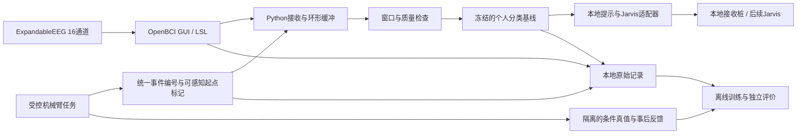

# LabPulse：简要技术设计

> 归档说明（2026-11-05）：正文保留2026-10-18初稿的计划与待确认状态，不作为当前实现报告。当前无设备进展见 [阶段入口](OFFLINE-START.md)。机械臂与Jarvis按用户要求延后。

v0.1｜2026-10-18｜原型前技术草案，所有运行步骤未执行验证

需求依据：[MVP PRD](02-MVP-PRD.md)。现状仅为设备验收、阻抗测试与可保存 CSV/BDF；尚无实时 Python 链路或 ErrP 模型。初稿用于今天提交，首次原型后更新。

## 1. 系统结构



机器人控制程序生成正常/异常条件，但在线分类器不能读取条件。事件时间必须尽量对应用户能看见的结果，不把命令发出时间默认等同机械动作完成时间。无法确定结果起点时记录为测量限制。

## 2. 技术选择与简化替代

| 决策 | 暂选方案及理由 | 简化替代与代价 |
|---|---|---|
| ADR-01 数据入口 | 现有 OpenBCI GUI→LSL→Python；手册第 9 页已有路径，减少驱动开发 | CSV/BDF 回放更易调试，但不验收实时；BrainFlow 直连为备选，需验证具体板型与协议，不能照搬普通 Cyton 参数 |
| ADR-02 识别 | Python、NumPy/SciPy、简单时间窗特征和正则化线性分类基线；先理解再优化 | 仅波形平均便于检查但不能替代单试次分类；暂不引入深度网络，以减少数据和调参需求 |
| ADR-03 记录 | 原始 EEG + events.csv + JSON 元数据；LSL 采用 LabRecorder/XDF 保留时间信息的路线优先验证 [S2] | 只保存 CSV 更简单，但必须另外保存时钟、单位与映射，不能丢失同步证据 |
| ADR-04 外部接口 | 本地 JSON 消息适配器，先写 JSONL 接收桩，后替换 Jarvis 传输 | 只显示本地提示最简单，但不能证明外部消息可用；不预设 Jarvis 为 HTTP 或已可接入 |
| ADR-05 工具平台 | MetaBCI 作为算法/范式参考，按需使用，先核实适用数据 [S1] | 最小 Python 脚本更容易解释；不为使用平台而引入全部依赖 |

MetaBCI 的 brainflow 模块与独立 BrainFlow 采集库需区分，不依据名字假定可互换。MNE 可作为后续 BDF/EEG 分析工具，但不作为第一版实时入口的必要依赖。

## 3. 时间同步与识别方法

**同步路线。** 先检查设备/GUI 是否提供采样计数、时间戳、marker 以及丢包信息，验证 16 通道的实际输出率。EEG 与程序事件进入统一 LSL 时间域，保留原始与校正时间；跨时钟须显式映射。LSL 文档介绍时钟偏移与抖动处理，但不能据此推断设备传输延迟或真实动作时间已被消除 [S2]。

使用独立物理参考测量事件起点，例如由实验室确认兼容的光电检测/触发记录方案。必须能把同一物理事件关联到 EEG 时间轴和程序标记；只在软件内比较两个时间值不够。厂家尚未确认 TTL 输入，禁止直接往未知引脚接信号。若当前设备无法记录独立参考，应先咨询可借设备或修改场景，不能把无法测量写成通过。按 PRD NFR-01 测量固定延迟、抖动与漂移；记录校正算法和原始测量值。

**先导范式。** 先做静止观察、单一异常类型，减少手部动作、眼动与视觉变化的混杂；再另行测试实际动手任务。先导阶段确定电极位置与参考方式、试次安排、窗口和伪迹规则，未经实测不声称特定电极位置有效。正常与异常尽量匹配视觉和动作特征；明确即使分类有效，也可能利用其他事件相关反应，不能仅凭准确率确认 ErrP 生理来源。

**基线流水线。** 原始采集→单位核对→有状态的因果滤波→按事件取窗→质量门控→时间分箱均值特征→正则化线性分类器→固定阈值。滤波频带、基线窗口、特征分箱与伪迹阈值作为配置，由先导数据确定；离线训练复用与在线相同的处理过程，不使用需要未来数据的双向滤波冒充实时性能。保留滤波状态与群延迟影响记录。

训练/验证/测试按完整块或会话划分；归一化、特征选择及阈值只用训练/验证数据拟合。测试前冻结配置，不反复查看测试结果调参。事后主观反馈与程序条件分开保存；暂不确定的标签不强行纳入训练。做标签泄漏审查、置换对照与眨眼/动作伪迹检查，按 PRD 报告全部试次与拒判。

## 4. 数据与模块对应

| 实体/模块 | 关键字段或职责 | 需求 |
|---|---|---|
| Session / acquisition.py | session_id、匿名 participant_id、模式、设备/GUI 版本、通道名称/位置、单位、配置和观测采样率、时钟来源、丢包统计 | FR-01 |
| Event / events.py | event_id、session_id、通用事件类型、源时间、映射时间、采样索引、起点定义、同步版本；正常/异常真值单独文件保存 | FR-02 |
| Trial / processing.py | event_id、窗口边界、quality、拒判原因、反馈值/时间、数据块分组 | FR-03 |
| Model / train.py | model_id、训练/验证会话、特征配置、阈值、软件版本、冻结时间 | FR-03 |
| Prediction / online.py | event_id、model_id、score、decision、quality、完成时间、mode | FR-03/05 |
| Alert / adapter.py | alert_id、event_id、schema_version、发送/接收时间、状态、重试数 | FR-04 |
| Report / evaluate.py | 指标、原始计数、延迟/同步报告、需求状态、证据路径 | FR-05 |

本地按 session_id 分目录保存原始记录、events.csv、truth.csv、predictions.jsonl、metadata.json 和配置快照，日志只追加。模型另存版本与训练清单；文件校验值用于追溯。数据由本人管理，原始 EEG 不提交公开仓库；保留期限和备份位置在采集前与实验室确认。

Jarvis 边界消息示例（拟议协议，尚未对接）：

```json
{"schema_version":"0.1","alert_id":"session01-event12","event_id":"event12","kind":"suspected_error_response","score":0.78,"threshold":0.70,"model_id":"baseline-v1","mode":"live","clock_domain":"lsl_local","event_time_s":1234.0,"prediction_time_s":1235.1,"quality":"accepted","message":"疑似错误相关脑电反应，请核查"}
```

示例分数、阈值和时间是格式示意，不是实验结果；score 不默认解释为校准概率。接口不含原始 EEG、条件标签、实验配方或机械臂控制指令。未接 Jarvis 时记录 local_stub 状态，不能记为外部接入成功。

## 5. 失败处理

断流/积压超限→停止判决并提示重连；不可恢复的时间错配→结束当前有效片段，禁止跨断点补窗；通道/模型配置不一致→拒绝加载；伪迹→拒判并保留原因；接收端失败→本地提示、有限重试和日志；文件写入失败→显著报错并停止新实验记录，避免用户以为数据已保存。模型未通过独立评价时界面标注实验性状态，不能显示“可靠识别”。

## 6. 拟定运行与验证步骤

当前工作区只有文档，没有以下脚本。命令均为计划，尚未执行；实现后应按真实环境修改并验证，不能现在作为可运行交付证据。

1. 在实验电脑记录操作系统、Python、GUI、固件与依赖版本；确认设备连接和 16 通道配置。
2. 在 GUI 启动数据流与 Networking 的 LSL 输出，核对流名称、类型、单位与实际采样率；先运行记录器保存样例，检查时间与丢包。
3. 计划实现以下命令；创建隔离环境后固定已验证的依赖版本，不在未知环境中直接安装全部平台。

```powershell
python -m venv .venv
.\.venv\Scripts\python.exe -m pip install -r requirements.txt
.\.venv\Scripts\python.exe -m neuroloop.acquire --config configs/pilot.json
.\.venv\Scripts\python.exe -m neuroloop.train --manifest data/train_manifest.json
.\.venv\Scripts\python.exe -m neuroloop.evaluate --manifest data/test_manifest.json
.\.venv\Scripts\python.exe -m neuroloop.online --config configs/demo.json --adapter local_stub
```

4. 逐项执行 PRD TC-01～05；另做物理同步校准、端到端延迟测量与独立测试。测试桩验证逻辑，真实设备验证采集，独立数据验证分类，三类证据不得混用。
5. 本地运行、不需要公开云部署。设备与电脑已有；新增采购、服务费用与指导资源未知，先列清单再申请，不假定零成本。Jarvis 配置和认证方式待维护者说明，秘密不进仓库。

## 7. 决策与最终状态记录

| AI 建议/初始想法 | 本稿处理 | 理由及后续检查 |
|---|---|---|
| 同时做情绪、负荷和 ErrP | 建议延期前两项，待本人确认 | 当前没有相应标签，优先单一任务 |
| 1000 Hz 即 1 ms 同步 | 不采纳 | 采样间隔不代表事件起点误差；必须物理校准 |
| 异常发生后立即提示 | 不作为脑电闭环 | 异常标记仅用于取窗，提示须来自质量合格的分类结果 |
| 将 MetaBCI 当作现成 ErrP 数据集 | 修正 | 官方是平台；须查具体数据、任务、许可与适配性 |

最终更新时，每个 FR 对应模块、测试证据及“实现/变更/删除/未完成”状态。当前全部为未完成，未产生分类、同步或接口实测结果。课程要求的简短 AGENTS.md 和开发决策记录在代码实现阶段维护，不将本技术草案当作已验证的实现。

## 来源与未决项

- S1：[MetaBCI 官方仓库](https://github.com/TBC-TJU/MetaBCI)，2026-10-18 访问；这里只引用平台定位，未确认可用 ErrP 数据。
- S2：[LSL 时间同步官方文档](https://labstreaminglayer.readthedocs.io/info/time_synchronization.html)，2026-10-18 访问。
- S3：[OpenBCI GUI Widget Guide](https://docs.openbci.com/Software/OpenBCISoftware/GUIWidgets/)，2026-10-18 访问；标准 GUI 文档不能替代 ExpandableEEG 修改版实机验证。
- S4：用户提供《ExpandableEEG 使用说明书》第 6、9、11 页，2026-10-18 阅读。

待解决事项统一见 PRD OQ-01～06。优先确认实时入口与同步测量资源；缺少该证据时，不能承诺 10/27 已完成真实 ErrP MVP。
